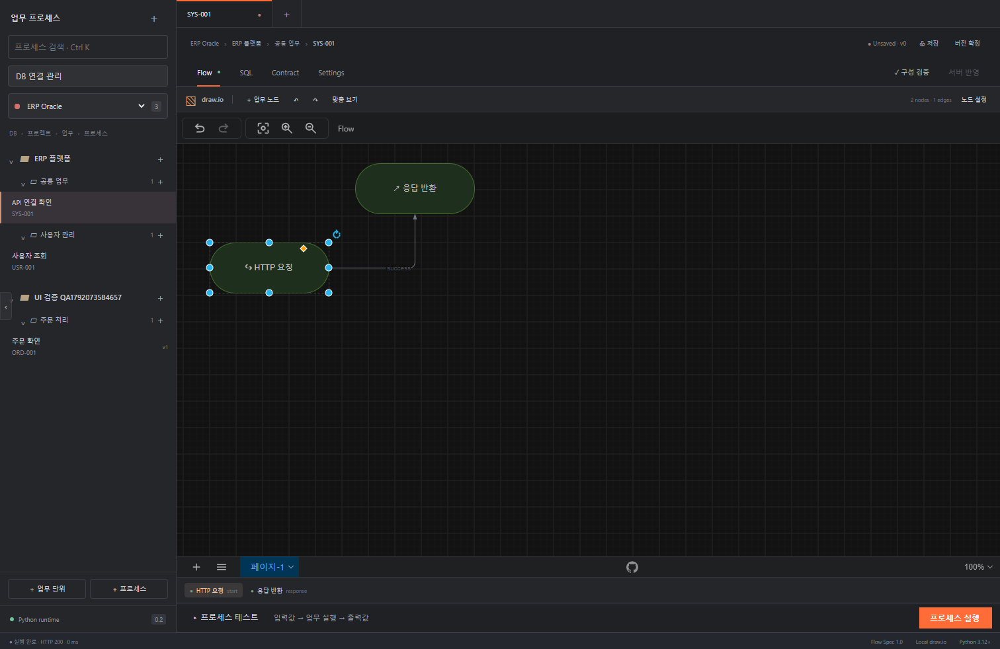

# Flow Studio · Python edition

**draw.io로 업무 프로세스를 설계하고 구성 검증 후 Python 코드로 서버에 반영합니다.** DB·프로젝트·업무·프로세스 탐색과 draw.io 편집을 중심으로 구성하고, 접을 수 있는 하단 테스트 영역에서 수동 입력과 실행 결과를 확인합니다.

처음 사용한다면 **[사용자 매뉴얼: DB 설정·사용법·만들기 실습](docs/사용자-매뉴얼.md)**부터 읽으세요. DB 없는 인사말 실습과 DB 조회 실습, 설정 화면 사진, 작업 로그 확인 방법을 포함합니다.

왼쪽 목록은 화면 가장자리 버튼으로 접고 펼칩니다. 캔버스의 노드를 클릭하면 오른쪽 설정 패널이 열립니다. SQL 노드는 실행 DB·SQL·바인딩 값·조회 결과 형태를, 분기·변환·검증·응답 노드는 해당 표현식이나 스키마를 편집합니다. 전체 JSON은 고급 설정에서 확인할 수 있습니다. 연결선을 클릭하면 오른쪽 패널에서 `success / error / true / false` 실행 경로를 선택하고 적용할 수 있습니다. 선택값은 연결선 이름과 Flow 명세에 함께 반영됩니다.

원본 [기획서](SPEC.md)는 유지했습니다. 이번 변경은 Python/FastAPI 실행 환경, 로컬 draw.io, 다중 DB 프로젝트 계층입니다. 이전 Java·React Flow 구현은 `legacy/`에 보존했습니다.



## 실행

현재 작업 환경은 설치와 프런트 빌드가 완료되어 있습니다.

```powershell
.\scripts\run.ps1
```

[http://127.0.0.1:8080](http://127.0.0.1:8080)을 열면 로컬 워크스페이스에 자동으로 연결됩니다. 토큰 입력은 필요하지 않습니다. `ERP Oracle → ERP 플랫폼 → 공통 업무 → SYS-001`은 DB 없이 실행할 수 있는 예제입니다. 하단 **프로세스 테스트**를 펼쳐 JSON 입력값을 작성하고 **프로세스 실행**을 누르면 Python Flow 엔진의 출력과 실행 추적을 확인할 수 있습니다.

새 환경에서는 Python 3.12+, Node.js 22.12+를 설치한 뒤 다음을 실행합니다.

```powershell
.\scripts\bootstrap.ps1 -Python 'C:\path\to\python.exe'
.\scripts\run.ps1
```

현재 머신에 번들된 Python은 `C:\Users\hyun4\.cache\codex-runtimes\codex-primary-runtime\dependencies\python\python.exe`입니다. Bootstrap은 프로젝트의 `.venv`에 의존성을 설치하고 SHA-256으로 확인한 공식 draw.io v32.4.1을 `.tools/drawio`에 설치합니다. Java는 새 버전 실행에 필요하지 않습니다.

## DB → 프로젝트 → 업무 단위 → 프로세스 ID

```text
ERP Oracle ── ERP 플랫폼 ── 공통 업무 ── SYS-001
                       └─ 사용자 관리 ── USR-001
CRM MySQL ── ERP 플랫폼 (같은 프로젝트)
          └─ 고객 서비스 ── 공통 업무 ── CRM-001
Core Tibero ─ 코어 업무 ── 공통 업무 ── CORE-001
```

- DB 선택은 해당 DB가 연결된 프로젝트를 필터링합니다.
- 프로젝트는 기준 DB 하나와 추가 DB 여러 개를 연결할 수 있습니다. **프로젝트 DB**에서 연결을 관리합니다.
- 업무 단위는 프로젝트에, 프로세스 ID는 업무 단위에 속합니다. 프로세스 ID는 같은 업무 단위에서 중복될 수 없습니다.
- 각 SQL 노드는 프로젝트에 연결된 DB 중 하나를 선택합니다. 한 프로세스에서 여러 DB를 순차 조회할 수 있습니다.
- 트랜잭션 하나는 한 DB 연결에만 속합니다. 트랜잭션 내부의 다른 DB 접근·중첩 트랜잭션·외부 HTTP 호출은 생성 전에 차단합니다. 분산 트랜잭션은 추가하지 않았습니다.
- 프로젝트 전체 생성에서는 모든 프로세스를 하나의 서버에 포함하고 API 경로·메서드 충돌을 검사합니다.

## 편집·테스트 흐름

1. **DB 선택** 후 컬렉션에서 프로세스를 열거나 프로젝트·업무·프로세스를 추가합니다.
2. **업무 노드** 메뉴로 의미가 지정된 노드를 추가합니다. draw.io에서 이동·연결·라벨 편집을 합니다. 연결선 이름은 `success`, `error`, `true`, `false` 중 하나입니다.
3. 하단 노드 목록 또는 **노드 설정**에서 노드를 선택해 설정 JSON과 실행 DB를 적용합니다. 일반 draw.io 도형을 임의로 실행 노드로 해석하지 않습니다.
4. 하단 **프로세스 테스트**에서 입력 명세에 맞는 JSON을 작성하고 **프로세스 실행**을 누릅니다. 입력은 HTTP 경로·헤더 매핑을 거치지 않고 프로세스 입력 명세에 직접 전달됩니다. 테스트 영역은 접고 펼칠 수 있습니다.
5. **SQL**에서 노드와 DB를 선택하고 바인딩 테스트 값을 입력합니다. SQL 편집기는 Monaco이며, Schema 버튼으로 테이블·컬럼을 조회합니다.
6. **저장**은 변경 가능한 초안을, **버전 확정**은 불변 실행 버전을 저장합니다. 동시 수정은 초안 버전으로 충돌을 검사합니다.
7. **구성 검증**을 통과하면 옆의 **서버 반영** 버튼이 활성화됩니다. 노드·연결 경로·입출력·실행 설정을 바꾸면 다시 검증해야 합니다. DB 연결 설정과 프로젝트 DB 연결 변경도 재검증 대상입니다. 단순 화면 이동·배율·도형 위치는 실행 구성에 포함하지 않습니다.
8. **서버 반영**은 현재 검증한 구성을 Python 모듈로 생성·구문 검사하고 활성 버전으로 등록합니다. 코드 경로와 변경 노드 수가 화면에 표시됩니다. 저장·버전 확정과는 별개이므로 미저장 구성도 검증 후 반영할 수 있습니다. 하단 프로세스 테스트는 계속 초안 미리보기로 동작합니다.

검증 증명은 서버에서 발급하며 15분 동안 유효합니다. 구성과 DB 범위가 달라지거나 서버가 재시작되면 재검증해야 합니다. 생성 코드는 기본적으로 `data/generated/<프로세스 UUID>/<코드 해시>/process.py`에 저장됩니다(`FLOW_DATA`로 기준 경로 변경 가능). 이전 코드는 보존하고 생성 성공 후에만 활성 버전을 교체합니다. 생성된 모듈은 검증된 Flow를 포함하며 공통 Python 엔진을 호출합니다.

반영된 코드는 `POST /api/processes/<프로세스 UUID>/execute`에 `{"input":{"name":"World"}}` 형태로 호출할 수 있습니다. 이 API는 반영된 스냅샷을 실제 실행하므로 명시적 트랜잭션 커밋과 DB 변경이 적용됩니다. UI 테스트의 롤백 미리보기와 구분됩니다. 실행 역할은 admin/runner, 서버 반영 역할은 admin/editor입니다.

그림의 위치·스타일은 UI 정보이며 실행 의미는 표준 Flow JSON의 `type/config/edges`에 있습니다. draw.io XML 동기화·가져오기는 서버에서 크기·압축·외부 엔티티를 검사합니다. JSON과 `.drawio/.xml` 가져오기, JSON 내보내기를 지원합니다.

## DB 연결과 비밀정보

왼쪽 **DB 연결 관리**에서 DB 종류, 주소, 사용자, 비밀번호 환경 변수명을 등록합니다. 비밀번호 자체는 UI나 Flow에 저장하지 않습니다. 예를 들어 `passwordSecretRef: MAIN_DB_PASSWORD`이면 서버 실행 터미널에 설정합니다.

```powershell
$env:MAIN_DB_PASSWORD = 'your-password'
.\scripts\run.ps1
```

- MySQL: PyMySQL, TLS 및 읽기 전용 DB 계정 권장.
- Oracle: python-oracledb Thin 모드. 지원 DB 버전·TLS·인증 조합을 실제 환경에서 확인해야 합니다.
- Tibero: pyodbc + 운영체제의 Tibero ODBC 드라이버 + DSN. TLS는 DSN/드라이버 설정에서 구성합니다.
- 읽기 전용 체크는 앱의 변경 명령 차단 정책입니다. SELECT 내부 함수의 부작용까지 보장하지 않으므로 실제 읽기 전용 권한을 DB 계정에 적용해야 합니다.
- 변경 미리보기는 읽기 전용 해제, development/test 환경, 테이블·트리거의 롤백 안전성 확인이 모두 필요합니다. 롤백 실패 시 성공으로 표시하지 않습니다.
- 명시적 트랜잭션 안의 변경은 미리보기 종료 시 롤백합니다. 트랜잭션 밖의 변경 노드는 각각 롤백하므로 후속 조회에 변경이 보이지 않을 수 있습니다. 의존하는 변경·조회 테스트에는 명시적 트랜잭션을 사용하세요.

실제 DB 검증 현황은 [지원 매트릭스](docs/support-matrix.md)를 참고하세요. 초기 DB 연결 항목은 미설정 예시이며 연결 성공을 가장한 데이터는 표시하지 않습니다.

## 생성 서버

기존 독립 서버 ZIP 생성 API와 아래 예제는 호환용으로 유지합니다. UI의 서버 생성 버튼은 제거했으며, 현재 편집 흐름은 구성 검증 → 서버 반영입니다.

[검증한 프로젝트 서버 예제 ZIP](artifacts/python-project-server.zip)

```powershell
python -m venv .venv
.\.venv\Scripts\python.exe -m pip install -r requirements.txt
$env:FLOW_RUNTIME_TOKEN = 'set-a-random-token-at-least-24-characters'
.\.venv\Scripts\python.exe -m uvicorn app:app --port 8081
```

생성 서버는 관리 서버·프런트엔드·draw.io·Java에 의존하지 않습니다. `FLOW_DATABASE_CONFIG`가 가리키는 외부 JSON 파일에 DB 설정을 제공하고 비밀번호는 환경 변수로 주입합니다. 관리 API와 SQL 편집 API는 포함하지 않습니다. 생성물에는 공통 엔진, Flow, OpenAPI, Dockerfile, 버전·파일 해시 manifest, 사용자 코드용 `extensions/`가 포함됩니다.

동일 Flow·생성기·런타임에서는 같은 ZIP을 생성하며 UI 위치와 XML은 생성물에 포함하지 않습니다. 재생성은 새 디렉터리에 풀어 사용자 확장 코드를 보존합니다. Tibero ODBC 드라이버는 생성물·기본 이미지에 포함하지 않으며 별도 설치와 배포 조건 확인이 필요합니다.

## 개발·검증

```powershell
# Python 테스트
.\.venv\Scripts\python.exe -m pytest -q

# 포맷·기본 코드 검사
.\.venv\Scripts\python.exe -m ruff check backend tests --select F
.\.venv\Scripts\python.exe -m ruff format --check backend tests
npm.cmd --prefix frontend run format:check

# UI 개발 서버: API와 로컬 draw.io를 8080 백엔드에 프록시
npm.cmd --prefix frontend run dev

# 실제 독립 서버 프로세스 생성·실행 검증
.\scripts\smoke.ps1

# 토큰 없는 로컬 개발 서버, 설치된 Edge의 격리된 headless 컨텍스트로 검사
npm.cmd --prefix frontend run test:e2e
```

브라우저 테스트는 새 프로필을 사용하고 외부 네트워크를 차단한 상태에서 로컬 draw.io 초기화, 요청 실행, DB 필터, 프로젝트 DB 연결, SQL 노드의 DB 선택을 확인합니다. 테스트 서버는 별도 `FLOW_DATA` 경로를 사용하는 것이 좋습니다.

## 구조·운영 경계

```text
backend/flowstudio/  FastAPI · SQLite 저장소 · 검증기 · 실행 엔진 · DB 어댑터 · 생성기
frontend/src/       Postman 스타일 React 화면 · draw.io 어댑터 · Monaco SQL 편집기
examples/           기존 Flow 1.0 예제
scripts/            설치 · 실행 · 테스트 · draw.io 설치
tests/              Python 단위·통합 테스트
legacy/             이전 Java / React Flow 구현
```

관리 데이터는 `data/flowstudio.sqlite3`에 저장합니다. WAL·외래키·초안 비교 갱신·불변 버전을 사용합니다. 현재 실행 취소 레지스트리는 단일 서버 프로세스 범위이므로 기본 단일 worker로 실행하세요. 운영용 사용자 계정·SSO·분산 작업 큐는 아직 포함하지 않습니다. 요청·응답 원문은 실행 기록에 보관하지 않으며 최근 실행 1000건·감사 이벤트 10000건을 유지합니다. 외부 HTTP 서비스는 `FLOW_SERVICE_CONFIG`의 허용된 URL과 Secret 참조로만 연결합니다.

로컬 실행 스크립트는 `FLOW_LOCAL_WORKSPACE=1`로 실행하며 loopback 접속·호스트와 동일 출처 조건에서 토큰 없이 워크스페이스를 엽니다. 관리 API를 별도로 배포할 때는 로컬 모드를 끄고 `FLOW_ADMIN_TOKEN`(전체), `FLOW_EDITOR_TOKEN`(설계·저장·버전), `FLOW_RUNNER_TOKEN`(미리보기·SQL·취소)을 사용할 수 있습니다. 이 경우 브라우저 앞단의 인증 연동이 필요합니다. 생성 서버의 API 인증 설정은 별개이며 유지됩니다.

Dockerfile은 제공하지만 이 환경에는 Docker가 없어 컨테이너 기동은 미검증입니다. 실제 Tibero·Oracle·MySQL의 드라이버별 동작도 별도 접속 환경이 필요합니다. [수용 기준](docs/acceptance.md), [검증 기록](docs/verification.md), [변경 결정](docs/decisions.md)을 확인하세요.
