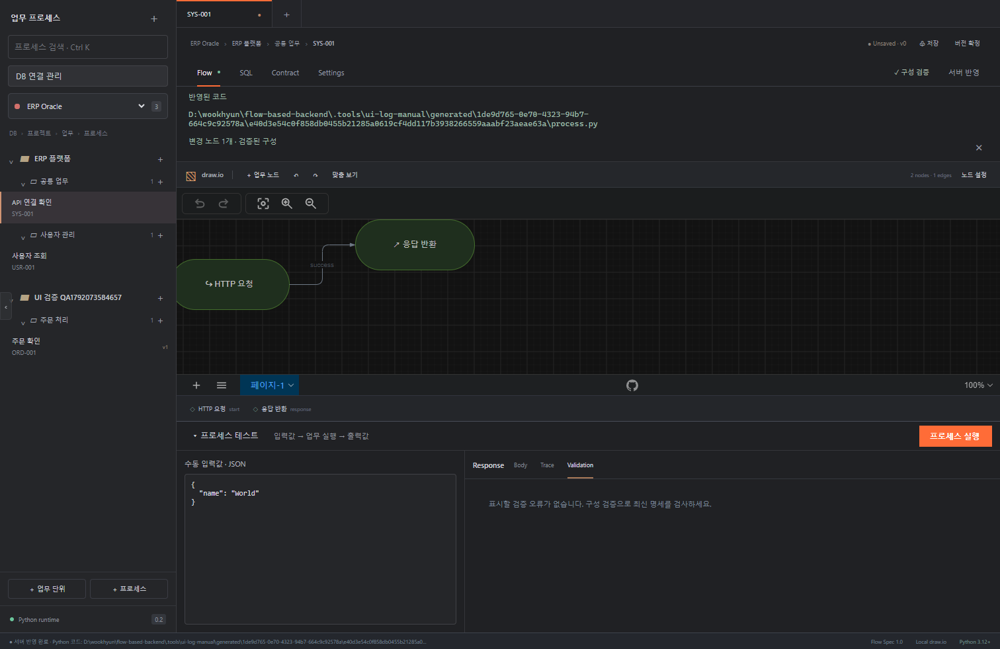
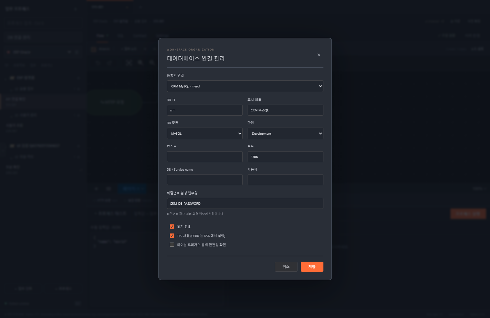
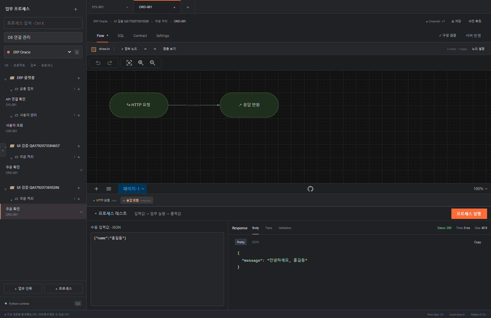
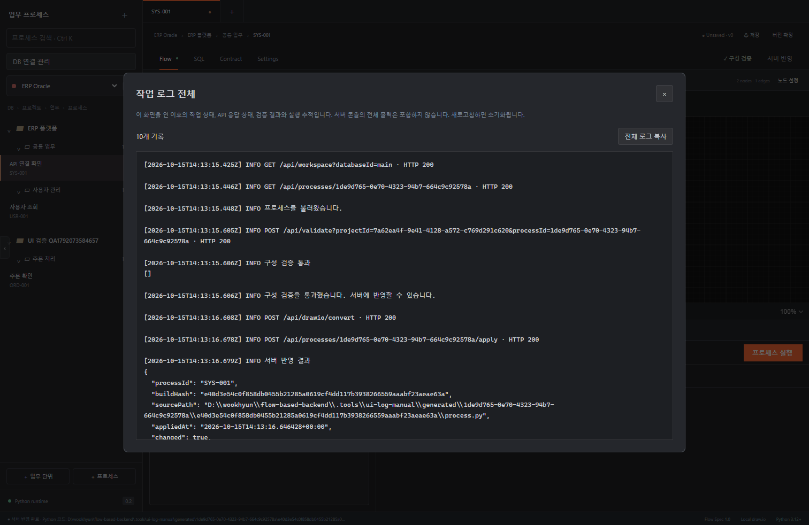

# Flow Studio 사용자 매뉴얼

처음 사용하는 분을 위한 **실행 → DB 등록 → 프로세스 만들기 → 테스트 → 구성 검증 → 서버 반영** 안내입니다.

처음에는 **실습 1**로 시작하세요. 실제 DB 연결 없이 입력·출력과 서버 반영을 익힐 수 있습니다. DB가 준비되면 **실습 2**로 진행합니다.

## 목차

1. [프로그램 실행](#1-프로그램-실행)
2. [화면과 용어](#2-화면과-용어)
3. [DB 설정](#3-db-설정)
4. [실습 1: 인사말 프로세스 만들기](#4-실습-1-인사말-프로세스-만들기)
5. [실습 2: DB에서 사용자 조회하기](#5-실습-2-db에서-사용자-조회하기)
6. [노드와 연결선 설정](#6-노드와-연결선-설정)
7. [알림과 전체 작업 로그](#7-알림과-전체-작업-로그)
8. [오류 해결](#8-오류-해결)

## 1. 프로그램 실행

PowerShell에서 프로젝트 폴더로 이동하고 실행합니다.

```powershell
Set-Location D:\wookhyun\flow-based-backend
.\scripts\run.ps1
```

브라우저에서 **http://127.0.0.1:8080**을 엽니다. 로컬 실행에는 토큰 입력이 필요 없습니다. 서버를 실행한 터미널은 열어 둡니다. 종료할 때는 터미널에서 `Ctrl+C`를 누릅니다.

처음 설치하는 환경에서 `.venv` 또는 화면 빌드가 없다는 메시지가 나오면 먼저 아래 명령을 실행합니다. Python 3.12 이상과 Node.js/npm, 설치 파일을 내려받을 인터넷 연결이 필요합니다.

```powershell
.\scripts\bootstrap.ps1
.\scripts\run.ps1
```

프로그램을 수정한 뒤에는 서버를 다시 시작하고 브라우저를 새로고침합니다. 이미 사용 중인 포트라면 `run.ps1 -Port 8081`로 실행하고 표시된 주소로 접속합니다.

## 2. 화면과 용어



| 위치·용어 | 역할 |
|---|---|
| 왼쪽 DB 선택 | 선택한 DB가 연결된 프로젝트를 표시합니다. |
| 프로젝트 | 여러 업무를 묶는 단위입니다. 여러 DB에 연결할 수 있습니다. |
| 업무 단위 | 프로젝트 안의 사용자 관리·주문 처리 같은 업무 묶음입니다. |
| 프로세스 ID | 업무 단위 안에서 유일한 실행 흐름의 이름입니다. 예: `HELLO-001`. |
| 가운데 draw.io | 노드와 연결선으로 처리 순서를 설계합니다. |
| 노드 클릭 | 오른쪽에서 해당 노드의 설정을 편집합니다. |
| 연결선 클릭 | 오른쪽에서 success/error/true/false 경로를 선택합니다. |
| 빈 캔버스 클릭 | 오른쪽 설정 패널을 닫습니다. |
| 화면 왼쪽 가장자리 ‹ / › | 왼쪽 업무 목록을 접고 펼칩니다. |
| 하단 프로세스 테스트 | JSON 입력값을 넣고 초안의 출력과 실행 추적을 확인합니다. 접고 펼칠 수 있습니다. |
| 하단 상태 문구 | 클릭하면 작업 로그 전체 모달이 열립니다. |

**화면의 DB 선택과 SQL 실행 DB는 다릅니다.** 왼쪽 DB 선택은 탐색용입니다. 실제로 어느 DB에 SQL을 실행할지는 각 SQL 노드의 **실행 DB**로 결정합니다.

| 버튼 | 하는 일 |
|---|---|
| 설정 적용 | 오른쪽 패널에서 편집한 값을 현재 Flow에 적용합니다. 저장·서버 반영까지 하지는 않습니다. |
| 저장 | 현재 초안을 저장합니다. |
| 버전 확정 | 저장된 불변 버전을 만듭니다. 서버 반영과 별개입니다. |
| 구성 검증 | 설정 누락, 타입, 연결 경로, SQL 허용 범위, DB 범위 등을 검사합니다. DB 쿼리를 실제 실행하지 않습니다. |
| 서버 반영 | 검증된 구성을 Python 모듈로 생성하고 활성 버전으로 등록합니다. 반영 동작 자체가 업무 SQL을 실행하지는 않습니다. |
| 프로세스 실행 | 하단 입력값으로 **현재 초안의 미리보기**를 실행합니다. |

## 3. DB 설정

### 3.1 준비할 정보

DB 관리자에게 다음 정보를 확인합니다. 초기 목록의 ERP Oracle·CRM MySQL·Core Tibero는 **연결이 완료된 DB가 아니라 설정 예시**입니다.

| 정보 | 예시 | 설명 |
|---|---|---|
| DB ID | `crm` | 프로그램 안에서 사용하는 연결 식별자. SQL 노드가 참조합니다. |
| 표시 이름 | `실습 MySQL` | 화면에 표시되는 이름입니다. |
| 종류 | MySQL / Oracle / Tibero | 실제 DB에 맞게 선택합니다. |
| 호스트 | `127.0.0.1` | DB 주소입니다. 서버가 다른 컴퓨터라면 해당 주소를 씁니다. |
| 포트 | MySQL 3306 / Oracle 1521 / Tibero 8629 | 예시값이며 실제 포트를 확인합니다. |
| DB / Service name | `flow_demo` / `FREEPDB1` | MySQL은 DB 이름, Oracle은 서비스 이름입니다. |
| 사용자 | `flow_reader` | 실습 테이블 조회 권한이 있는 계정입니다. |
| 비밀번호 환경 변수명 | `CRM_DB_PASSWORD` | 비밀번호 자체가 아니라, 비밀번호를 담은 환경 변수의 이름입니다. |
| 환경 | Development / Test / Production | 실습은 Development 또는 Test로 구분합니다. |
| TLS | DB 환경에 맞는 값 | DB 서버의 TLS 설정과 맞춰야 합니다. 연결 오류 때문에 무조건 끄지 않습니다. |
| ODBC DSN | `FLOW_TIBERO` | Tibero 드라이버와 함께 운영체제에서 미리 등록한 DSN입니다. |

### 3.2 연결 정보 등록

1. 왼쪽 **DB 연결 관리**를 누릅니다.
2. 기존 예시를 수정하려면 **등록된 연결**에서 선택합니다. 새 연결은 새 연결 항목을 선택하고 DB ID부터 입력합니다.
3. 위 정보를 입력합니다. 처음에는 **읽기 전용**을 켜 둡니다.
4. **저장**을 누릅니다.



비밀번호는 화면에 입력하지 않습니다. 예를 들어 환경 변수명을 `CRM_DB_PASSWORD`로 저장했다면, 서버를 실행할 **같은 PowerShell 창**에서 다음과 같이 설정합니다.

```powershell
# 실행 중인 서버는 Ctrl+C로 종료한 다음 설정합니다.
$env:CRM_DB_PASSWORD = '실제 DB 비밀번호'
.\scripts\run.ps1
```

환경 변수는 해당 터미널과 여기서 실행한 서버에 전달됩니다. 새 터미널을 열면 다시 설정해야 합니다. 매뉴얼의 예시 비밀번호를 그대로 사용하지 않습니다.

Oracle은 현재 Python Thin 드라이버를 사용합니다. Tibero는 별도로 설치한 Tibero ODBC 드라이버·DSN이 필요하며, UI에 주소만 입력한다고 드라이버가 설치되지는 않습니다. Tibero의 TLS 설정은 DSN/드라이버 쪽에서 구성합니다.

### 3.3 프로젝트에 여러 DB 연결

1. DB를 등록합니다.
2. 프로세스를 연 뒤 상단 경로의 **프로젝트 이름**을 클릭합니다.
3. **프로젝트 DB 연결**에서 필요한 DB들을 체크하고 저장합니다.
4. SQL 노드마다 **실행 DB**를 선택합니다.

예: 같은 프로세스에서 고객 조회는 CRM DB, 주문 조회는 ERP DB를 사용할 수 있습니다. 단, **하나의 트랜잭션으로 여러 DB를 묶는 분산 트랜잭션은 지원하지 않습니다.**

### 3.4 실제 연결 확인

등록만으로 접속 성공이 확인되는 것은 아닙니다. SQL 노드를 선택하고 **SQL → Run SQL**로 간단한 조회를 실행해 확인합니다.

```sql
-- MySQL
SELECT 1 AS value
```

```sql
-- Oracle / Tibero
SELECT 1 AS "value" FROM dual
```

이 테스트 SQL에는 바인딩 값이 필요 없으므로 **바인딩 테스트 값**은 `{}`로 입력합니다. 전체 프로세스 검증은 임시 SQL 편집을 마친 뒤 원래 업무 SQL로 되돌리고 수행합니다.

## 4. 실습 1: 인사말 프로세스 만들기

**목표:** `{"name":"홍길동"}`을 입력하면 `{"message":"안녕하세요, 홍길동"}`을 출력합니다. DB 연결은 필요 없습니다.

### 단계 A. 프로젝트·업무·프로세스 만들기

1. 왼쪽 DB에서 **ERP Oracle**을 선택합니다. 여기서는 목록을 구성하는 기준 DB로만 사용합니다.
2. 왼쪽 **업무 프로세스** 제목 옆 `＋`를 누릅니다.
3. 프로젝트 코드에 `DEMO`, 이름에 `실습 프로젝트`를 입력하고 저장합니다.
4. 새 프로젝트 옆 `＋`를 눌러 업무 코드 `COMMON`, 이름 `공통 업무`를 만들고 저장합니다.
5. 해당 업무 옆 `＋`를 눌러 프로세스 ID `HELLO-001`, 이름 `인사말 만들기`를 입력하고 저장합니다.

이미 같은 코드를 만들었다면 기존 항목을 사용하거나 숫자를 바꿉니다. 새 프로세스에는 시작·응답 노드와 success 연결선이 기본으로 만들어집니다.

### 단계 B. 입력·출력 계약 설정

**Contract** 탭에서 왼쪽 Input에 다음을 입력합니다.

```json
{
  "type": "object",
  "properties": {"name": {"type": "string"}},
  "required": ["name"],
  "additionalProperties": false
}
```

오른쪽 Output에는 다음을 입력하고 **계약 적용**을 누릅니다.

```json
{
  "type": "object",
  "properties": {"message": {"type": "string"}},
  "required": ["message"]
}
```

이 설정은 입력에 문자열 `name`이 필요하고, 출력에 문자열 `message`가 있어야 한다는 뜻입니다.

### 단계 C. 출력 로직 설정

1. **Flow**로 돌아갑니다.
2. 캔버스의 **응답 반환** 노드를 클릭합니다.
3. 오른쪽 **출력값 · 표현식**에 아래 JSON을 입력합니다.
4. 입력 칸 밖을 한 번 클릭해 JSON 편집을 마친 뒤 **설정 적용**을 누릅니다.

```json
{
  "message": {
    "op": "concat",
    "args": ["안녕하세요, ", {"ref": "input.name"}]
  }
}
```

`concat`은 문자열을 이어 붙입니다. `input.name`은 수동 입력 JSON의 `name` 값입니다. Python 코드를 직접 입력하는 칸은 아닙니다.

### 단계 D. 수동 실행

1. 빈 캔버스를 클릭해 오른쪽 설정 패널을 닫습니다.
2. 하단 **프로세스 테스트**를 펼칩니다.
3. 입력값을 아래처럼 작성하고 **프로세스 실행**을 누릅니다.

```json
{"name": "홍길동"}
```

출력에서 다음 결과를 확인합니다.

```json
{"message": "안녕하세요, 홍길동"}
```

**Trace** 탭에서는 실행한 노드와 성공·실패, 소요 시간을 확인합니다. 이름을 바꿔 한 번 더 실행해 보세요.



위 캡처는 테스트용 프로젝트에서 같은 표현식을 실행한 예시입니다. 캡처의 프로젝트명·프로세스 ID가 달라도 입력과 출력이 위 예제와 같으면 실습에 성공한 것입니다.

### 단계 E. 저장·검증·서버 반영

1. **저장**을 눌러 초안을 보관합니다.
2. **구성 검증**을 누릅니다. 하단 **Validation**에서 오류가 없는지 확인합니다.
3. 활성화된 **서버 반영**을 누릅니다.
4. 상단 알림과 하단 상태에서 생성된 `process.py` 경로를 확인합니다.
5. 출력 표현식을 바꾸고 설정 적용을 눌러 보세요. **서버 반영이 비활성화**됩니다. 다시 구성 검증을 해야 반영할 수 있습니다.

기본 저장 위치는 `data/generated/<내부 프로세스 UUID>/<코드 해시>/process.py`입니다. 이전 코드는 보존됩니다. 설정한 `FLOW_DATA`가 있다면 그 경로 아래에 생성됩니다. 화면의 `HELLO-001`과 파일 경로의 UUID는 서로 다른 식별자입니다.

**서버 반영은 코드를 등록하는 작업입니다. DB 업무를 즉시 실행하거나 외부 서버에 배포하는 버튼이 아닙니다.** 하단 테스트는 계속 현재 초안의 미리보기를 실행합니다. 반영된 버전의 실제 실행 API는 `POST /api/processes/<내부 UUID>/execute`, 본문은 `{"input":{"name":"홍길동"}}`입니다. 실제 실행은 DB 변경·커밋이 가능하므로 조회 실습을 마친 뒤 별도로 사용합니다.

## 5. 실습 2: DB에서 사용자 조회하기

**목표:** `userId`로 DB를 조회하고, 사용자가 있으면 반환하고 없으면 업무 오류를 냅니다. 초기 예제 **ERP 플랫폼 → 사용자 관리 → USR-001 사용자 조회**를 활용합니다.

### 단계 A. 실습 테이블 준비

아래 SQL은 **별도 DB 관리 도구**에서, 실습 DB/스키마에 테이블을 만들 권한이 있는 계정으로 실행합니다. 프로그램의 SQL 편집기는 테이블 생성(DDL)을 허용하지 않습니다. 이미 같은 이름의 테이블이 있다면 중복 생성하지 말고 DB 관리자에게 확인합니다.

MySQL 예시:

```sql
CREATE TABLE flow_demo_users (
  id INT PRIMARY KEY,
  name VARCHAR(100) NOT NULL
);
INSERT INTO flow_demo_users (id, name) VALUES (1, '홍길동');
COMMIT;
```

Oracle / Tibero 예시:

```sql
CREATE TABLE flow_demo_users (
  id NUMBER(10) PRIMARY KEY,
  name VARCHAR2(100) NOT NULL
);
INSERT INTO flow_demo_users (id, name) VALUES (1, '홍길동');
COMMIT;
```

등록한 조회 계정에서 이 테이블이 보이고 SELECT 권한이 있어야 합니다. 다른 소유자의 테이블이라면 허용된 스키마 이름을 SQL에 명시합니다.

### 단계 B. SQL 노드 설정

1. 3장의 방법으로 실제 DB 연결과 비밀번호 환경 변수를 설정합니다.
2. **ERP 플랫폼 → 사용자 관리 → USR-001**을 엽니다.
3. 사용할 DB가 프로젝트에 연결되어 있는지 확인합니다. 새 DB라면 상단 프로젝트 이름을 눌러 연결을 추가합니다.
4. 캔버스에서 **사용자 조회** SQL 노드를 클릭합니다.
5. **실행 DB**를 실제 연결로 선택합니다.
6. SQL을 다음과 같이 바꿉니다.

```sql
SELECT id AS "id", name AS "name"
FROM flow_demo_users
WHERE id = :userId
```

**SQL 바인딩 값 · JSON**은 다음과 같이 두고, **조회 결과**는 `0개 또는 1개 행`을 선택합니다. **설정 적용**을 누릅니다.

```json
{"userId": {"ref": "input.userId"}}
```

SQL에는 `:userId`라는 자리를 두고 입력값을 바인딩합니다. 입력 문자열을 SQL 본문에 이어 붙이지 않습니다.

### 단계 C. 노드 단독 테스트와 전체 프로세스 테스트

**SQL** 탭에서 해당 노드를 선택합니다. **바인딩 테스트 값 · JSON**에는 표현식이 아닌 실제 값을 넣습니다.

```json
{"userId": 1}
```

**Run SQL**을 눌러 ID 1의 행이 조회되는지 확인합니다. 그다음 하단 **프로세스 테스트**에서도 `{"userId":1}`을 입력하고 **프로세스 실행**을 누릅니다.

정상 출력 예:

```json
{"id": 1, "name": "홍길동"}
```

이어서 없는 ID인 `{"userId":999}`로 실행합니다. 예제에서는 **사용자 없음** 경로로 이동해 `USER_NOT_FOUND` 업무 오류를 반환합니다. Trace에서 SQL 조회 → 조건 분기 → 사용자 없음 순서를 확인합니다.

입력 `{}` 또는 `{"userId":"문자열"}`도 시험해 보세요. 필수값·타입이 입력 계약과 다르면 실패하는 것이 정상입니다. 결과를 확인한 뒤 저장 → 구성 검증 → 서버 반영 순으로 진행합니다.

### 단계 D. 여러 DB를 사용하는 경우

프로젝트에 두 DB를 연결하고 SQL 노드를 각각 추가하면 각 노드에 다른 실행 DB를 지정할 수 있습니다. 다른 노드의 출력을 참조할 때는 오른쪽 패널의 실제 노드 ID를 확인합니다. 예를 들어 ID가 `query`이고 단일 행 조회라면 `nodes.query.output.row.id`로 조회된 ID를 참조합니다. 자동 생성된 ID가 다르면 실제 ID로 바꿔야 합니다.

## 6. 노드와 연결선 설정

새 노드는 **＋ 업무 노드**에서 추가합니다. 일반 draw.io 도형을 임의로 추가하는 방식은 실행 노드를 만들지 않습니다. 시작 노드는 프로세스당 하나여야 합니다. 출력 연결점을 드래그해 다음 노드에 연결한 후 선을 클릭해 경로를 설정합니다.

| 노드 | 주로 입력하는 설정 |
|---|---|
| 입력 검증 | 검증할 JSON Schema, 검증 대상 표현식 |
| 데이터 변환 | 변환할 필드와 표현식 |
| 조건 분기 | true/false를 반환하는 조건 표현식 |
| SQL 조회 | 실행 DB, SQL, 바인딩 값, 여러 행/단일 행 |
| SQL 변경 | 실행 DB, INSERT/UPDATE/DELETE, 바인딩 값 |
| 외부 API 호출 | 서비스 ID, 호출 경로, 전달할 값 |
| 트랜잭션 시작 | 실행 DB, 격리 수준 |
| 커밋·롤백 | 앞선 트랜잭션의 연결을 사용하며 별도 DB 선택은 없습니다. |
| 업무 오류 | 오류 코드·메시지·상태 코드 |
| 응답 노드 | 상태 코드, 최종 출력 표현식 |

연결선 패널에서는 다음 중 하나를 선택하고 **설정 적용**을 누릅니다.

| 경로 | 용도 |
|---|---|
| success | 일반 노드의 정상 처리 후 이동 |
| error | 처리 오류 시 이동. 트랜잭션 노드 오류 경로는 지원하지 않습니다. |
| true | 조건 분기 결과가 참일 때 이동 |
| false | 조건 분기 결과가 거짓일 때 이동 |

조건 분기에는 true·false 두 경로가 모두 있어야 합니다. 일반 노드에 true/false를 연결하거나, 응답 노드 뒤에 선을 추가하거나, 같은 노드의 같은 출력 경로를 두 번 연결하면 구성 검증에서 실패합니다.

**SQL 변경 실습은 조회 실습과 구분하세요.** 미리보기 변경 작업은 개발·테스트 환경, 읽기 전용 해제, 롤백 안전성 확인이 필요합니다. 미리보기의 명시적 커밋은 롤백되지만 실제 실행 API의 커밋은 반영됩니다. 같은 테스트 안에서 변경 후 조회 결과를 유지하려면 같은 DB의 명시적 트랜잭션을 사용합니다. 외부 HTTP 호출의 부작용은 DB 롤백으로 취소되지 않습니다.

## 7. 알림과 전체 작업 로그

### 상단 반영 알림 닫기

서버 반영 후 나오는 **반영된 코드 / 변경 노드** 알림 오른쪽 `×`를 누르면 알림만 사라집니다. 반영한 코드나 검증 상태는 삭제되지 않습니다. 다음 서버 반영 때 새 알림이 다시 나타납니다.

### 하단 상태로 로그 열기

1. 화면 맨 아래의 상태 문구를 클릭합니다. 긴 경로가 잘려 보이더라도 클릭할 수 있습니다.
2. **작업 로그 전체** 모달에서 시간순 기록과 긴 메시지 전체를 확인합니다.
3. **전체 로그 복사**를 누르면 현재 기록을 한꺼번에 복사합니다.
4. 오른쪽 `×` 또는 `Esc`로 닫습니다.



포함되는 기록은 화면을 연 이후의 상태 메시지, API 응답 상태, 구성 검증 상세, 프로세스 테스트 실행 추적, 서버 반영 경로·변경 요약입니다. 로그는 새로고침하면 초기화됩니다. **서버 터미널의 전체 콘솔 출력이나 과거 모든 실행 기록을 수집하는 기능은 아닙니다.** 예기치 않은 서버 오류가 나면 이 작업 로그와 서버 터미널의 오류 부분을 함께 확인합니다.

## 8. 오류 해결

| 증상 | 확인할 내용 |
|---|---|
| DB 연결 실패 | 호스트·포트·서비스/DB 이름·사용자·TLS·접속 권한을 확인합니다. |
| 비밀번호 관련 오류 | 환경 변수명이 설정 화면과 일치하는지, 같은 터미널에서 서버를 다시 시작했는지 확인합니다. |
| 실행 DB 목록에 원하는 DB가 없음 | 해당 프로젝트의 DB 연결에 추가합니다. |
| 구성 검증은 통과했는데 SQL 실행 실패 | 구성 검증은 실제 DB 접속·테이블 존재·SQL 실행 결과를 확인하지 않습니다. SQL 탭에서 실제 조회를 시험합니다. |
| 허용 경로 오류 | 선을 클릭해 일반 노드는 success/error, 분기 노드는 true/false로 수정합니다. |
| 도달할 수 없는 노드 | 시작 노드에서 해당 노드까지 연결되어 있는지 확인합니다. |
| 현재 경로에서 보장되지 않는 노드 출력 | 참조한 노드가 반드시 먼저 실행되는지 확인합니다. 오류 경로에서 정상 출력은 보장되지 않습니다. |
| 서버 반영 버튼 비활성화 | 먼저 구성 검증을 합니다. 설정 변경·프로세스 전환·DB 설정 변경 후에는 다시 검증합니다. |
| 검증 만료 | 검증 증명은 15분 유효하며 서버 재시작 시 사라집니다. 다시 검증합니다. |
| 출력 계약 오류 | Contract의 Output과 응답 노드가 반환하는 필드·타입이 일치하는지 확인합니다. |
| 초안 저장 충돌 | 다른 화면에서 먼저 저장했을 수 있습니다. 변경 내용을 별도로 보관하고 최신 초안을 다시 엽니다. |
| 작업을 완료하지 못했습니다 | 하단 상태를 클릭해 작업 로그를 확인하고 서버 터미널의 오류도 함께 확인합니다. |

현재 검증 환경과 실제 DB별 미검증 범위는 [검증 기록](verification.md), [DB 지원 현황](support-matrix.md)을 참고하세요. 실제 Oracle·MySQL·Tibero 접속 성공은 사용할 DB 환경에서 별도로 확인해야 합니다.
